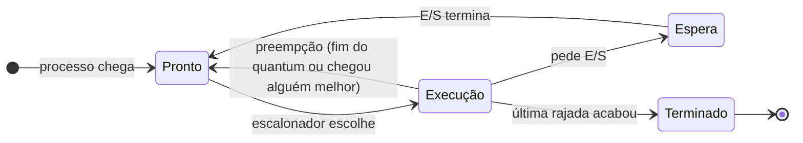

# Simulador de Escalonamento de Processos

Trabalho da disciplina de Sistemas Operacionais (FURB). Java 17+ e Swing, sem dependências externas.


## Sumário

- [Introdução](#introdução)
- [O que mudou na segunda versão](#o-que-mudou-na-segunda-versão)
- [Como executar](#como-executar)
- [Conceitos: estados e objetivos](#conceitos-estados-e-objetivos)
- [Algoritmos implementados](#algoritmos-implementados)
- [Métricas](#métricas)
- [Regras da simulação](#regras-da-simulação)
- [Arquitetura do código](#arquitetura-do-código)
- [Interface gráfica](#interface-gráfica)
  - [Processos aleatórios](#processos-aleatórios)
  - [Chegada aleatória](#chegada-aleatória)
  - [Quantum individual no Round Robin](#quantum-individual-no-round-robin)
  - [Salvar e carregar exemplos](#salvar-e-carregar-exemplos)
- [Validação e resultados](#validação-e-resultados)
- [Conclusão](#conclusão)

## Introdução

Este trabalho é um simulador de escalonamento de processos, feito em Java com interface gráfica em Swing para a disciplina de Sistemas Operacionais. Ele mostra, passo a passo, como o sistema operacional decide qual processo usa a CPU a cada instante, e compara cinco algoritmos de escalonamento com as mesmas métricas.

O usuário cadastra um conjunto de processos, escolhe o algoritmo e acompanha a simulação: os processos mudam de estado no diagrama, o gráfico de Gantt cresce a cada unidade de tempo e, no fim, aparecem as métricas de desempenho. Um botão de comparação roda o mesmo conjunto em todos os algoritmos e destaca qual foi melhor em cada critério.

Além disso, o simulador permite:

- salvar um conjunto de processos em arquivo e carregá-lo depois;
- gerar de 1 a 1000 processos aleatórios;
- sortear só a ordem ou os instantes de chegada dos processos que já estão na tabela;
- dar a cada processo um quantum próprio no Round Robin.

Escolhemos Java porque é a linguagem que o grupo mais domina, e Swing porque já vem com o JDK, sem nenhuma biblioteca externa. O programa roda em qualquer máquina com Java 17 ou mais novo.

## O que mudou na segunda versão

Depois da primeira versão, o professor pediu três mudanças, e todas foram implementadas:

| Pedido | O que foi feito | Onde está explicado |
| --- | --- | --- |
| **Load** | Botões **Salvar...** e **Carregar...** guardam e leem conjuntos de processos em arquivos `.txt`. A pasta `exemplos` traz conjuntos prontos. | [Salvar e carregar exemplos](#salvar-e-carregar-exemplos) |
| **Chegada aleatória** | Botão **Chegada aleatória**, que mantém os processos e muda só a chegada: embaralha a ordem ou sorteia instantes novos. Algum processo sempre chega em 0. | [Chegada aleatória](#chegada-aleatória) |
| **Quantum do processo, e não da CPU** | No Round Robin, a tabela ganha a coluna **Quantum**, e cada processo pode ter o seu. Quem fica em branco usa o quantum padrão. | [Quantum individual](#quantum-individual-no-round-robin) |

Também melhoramos outras partes do simulador:

- **Processos aleatórios:** o botão agora pergunta quantos processos gerar (de 1 a 1000).
- **Tela com muitos processos:** o diagrama de estados mostra **+N** quando os processos não cabem.
- **Gantt:**
  - os nomes das linhas ficam fixos ao rolar para a direita;
  - nomes com três dígitos não ficam mais cortados;
  - só o trecho visível é desenhado, então a tela continua rápida com centenas de processos.
- **Testes:** o `TesteNucleo` ganhou casos novos para o quantum individual e para salvar e carregar arquivos.

## Como executar

- **Pelo .jar:** dois cliques em `SimuladorEscalonamento.jar`, ou `java -jar SimuladorEscalonamento.jar` no terminal (Java 17 ou mais novo). Deixe a pasta `exemplos` ao lado do .jar para o botão **Carregar...** já abrir nela.
- **Pelo código:** `compilar-e-rodar.bat` no Windows ou `./compilar-e-rodar.sh` no Linux/Mac, executados na pasta do projeto.
- **Na IDE (IntelliJ, Eclipse, NetBeans):** marcar a pasta `src` como código-fonte e rodar a classe `simulador.gui.App`.
- **Testes do núcleo:** rodar a classe `simulador.TesteNucleo` (depois de compilar, `java -cp out simulador.TesteNucleo`). Ela mostra `[OK]` ou `[FALHA]` em cada caso e termina com "Todos os testes passaram.".

## Conceitos: estados e objetivos

O simulador segue o modelo visto em aula, em que todo processo está sempre em um de três estados: **Pronto**, **Execução** ou **Espera**. Acrescentamos o estado **Terminado** para marcar os processos que já acabaram.

- **Pronto:** o processo tem tudo o que precisa e só espera a CPU. Pode haver vários processos prontos, organizados numa fila.
- **Execução:** o processo está usando a CPU. Como há uma única CPU, só um processo pode estar neste estado por vez.
- **Espera:** o processo pediu uma operação de entrada/saída (E/S) e não pode usar a CPU até ela terminar.



A transição *Pronto → Execução* é a única decisão do escalonador. As outras acontecem por eventos do próprio processo (pedir E/S, terminar) ou do sistema (fim do quantum, chegada de um processo mais prioritário).

O **escalonador** é quem decide qual processo da fila de prontos vai para a CPU. Segundo a aula, ele deve buscar quatro objetivos:

- manter a CPU ocupada;
- balancear a utilização do processador;
- maximizar o throughput, com tempos de resposta razoáveis para usuários interativos;
- tratar todos os processos igualmente, evitando o *starvation* (quando um processo fica esperando indefinidamente).

Nenhum algoritmo atinge todos ao mesmo tempo, e o simulador serve justamente para mostrar essas trocas.

## Algoritmos implementados

O professor não exigiu algoritmos específicos, então escolhemos os cinco clássicos da literatura. Juntos, eles cobrem todos os objetivos do escalonador. Um algoritmo **preemptivo** pode tirar um processo da CPU antes de ele terminar a rajada; um **não preemptivo** deixa o processo rodar até terminar a rajada ou pedir E/S.

### FCFS (First-Come, First-Served)

O primeiro processo a chegar na fila é o primeiro a ser atendido, como uma fila de banco. É não preemptivo e o mais simples de todos. O problema é o *efeito comboio*: um processo longo na frente faz todos os curtos esperarem muito.

### SJF (Shortest Job First)

Escolhe o processo com a menor rajada de CPU. Para um processo com E/S, conta a próxima rajada de CPU, e não o total do processo. É não preemptivo: uma vez escolhido, o processo roda até o fim da rajada.

O SJF minimiza o tempo médio de espera, mas exige saber a duração das rajadas com antecedência, o que um sistema real só consegue estimar. Processos longos podem sofrer starvation se sempre chegarem processos curtos.

### SRTF (Shortest Remaining Time First)

É a versão preemptiva do SJF. Quando chega um processo com tempo restante menor que o do processo em execução, ele toma a CPU. Em caso de empate, o processo atual continua. Costuma dar o menor tempo médio de espera de todos, com o mesmo risco de starvation do SJF.

### Prioridade

Cada processo tem um número de prioridade, e o escalonador escolhe o mais prioritário (no simulador, **número menor = mais prioritário**). Pode ser preemptivo ou não.

Sem cuidado, processos de baixa prioridade podem nunca rodar. Para isso implementamos o **aging** (envelhecimento): a cada N unidades de tempo na fila, o processo ganha um nível de prioridade, até eventualmente ser atendido. O aging só vale enquanto o processo está na fila; quando ele volta para lá, a contagem recomeça da prioridade original.

### Round Robin

Cada processo roda por no máximo um **quantum** (fatia de tempo). Se não terminar, volta para o fim da fila e o próximo assume. Se não houver ninguém na fila, ele continua na CPU mesmo depois do quantum, porque não há para quem ceder a vez.

É preemptivo e trata todos igualmente, o que dá bons tempos de resposta para usuários interativos. Um quantum muito pequeno gera muitas trocas de contexto; um muito grande faz o algoritmo se comportar como o FCFS. Seguindo a convenção do Silberschatz, quem chega na fila entra antes do processo que acabou de perder a CPU.

O quantum é definido **por processo**: o valor da caixa **Quantum padrão** vale para quem não tem um próprio, e a coluna **Quantum** da tabela define o de cada um (veja [Quantum individual no Round Robin](#quantum-individual-no-round-robin)).

## Métricas

Cada objetivo do escalonador visto em aula virou um número que o simulador calcula, para que os algoritmos possam ser comparados pelos mesmos critérios.

| Objetivo da aula | Métrica | Como é calculada |
| --- | --- | --- |
| Manter a CPU ocupada / balancear a utilização | Utilização da CPU (%) | tempo com a CPU ocupada ÷ tempo total |
| Maximizar o throughput | Throughput | processos concluídos ÷ tempo total |
| Tempo de resposta razoável | Tempo de resposta | 1ª execução − chegada |
| Evitar starvation | Maior espera seguida | maior trecho contínuo que um processo passou na fila de prontos |

Além dessas, o simulador mostra:

- o **tempo de espera**: total de tempo na fila de prontos (o tempo em E/S não conta);
- o **turnaround**: fim − chegada, ou seja, o tempo total do processo no sistema;
- o número de **preempções**: vezes em que um processo foi tirado da CPU para outro entrar.

A tela mostra os valores de cada processo e as médias do conjunto.

## Regras da simulação

Algumas decisões de modelagem afetam os números. Por isso, elas ficam registradas aqui:

- **Tempo discreto:** a simulação avança de uma em uma unidade de tempo, e todas as durações são números inteiros.
- **Uma CPU:** só um processo executa por vez.
- **Troca de contexto sem custo:** trocar de processo não gasta tempo de CPU. As trocas são só contadas, na métrica de preempções.
- **E/S em paralelo:** cada processo em Espera faz a sua E/S ao mesmo tempo que os outros, sem fila de dispositivo.
- **Chegadas no mesmo instante:** entram na fila de prontos em ordem de PID.
- **Ordem de entrada na fila dentro de um instante:**
  1. primeiro, os processos que acabaram de chegar;
  2. depois, os que terminaram a E/S;
  3. por último, o processo que sofreu preempção.
- **Desempates:**
  - no SJF, ganha quem está há mais tempo na fila;
  - no SRTF e na Prioridade preemptiva, o processo que já está na CPU continua; se a CPU estiver livre, ganha o primeiro da fila.
- **CPU ociosa:** se nenhum processo chegou ainda, a CPU fica parada e esse tempo conta contra a utilização. Os sorteios de chegada sempre colocam um processo em t=0 para evitar isso.

## Arquitetura do código

O código separa o núcleo da simulação da interface gráfica. Assim, os algoritmos podem ser testados sem abrir a tela, e a tela só consulta o estado do simulador para desenhar.

```
src/simulador/
├── Estado.java              enum PRONTO, EXECUCAO, ESPERA, TERMINADO
├── Processo.java            dados do processo (chegada, prioridade, rajadas, quantum) e tempos registrados
├── Escalonador.java         interface que todo algoritmo implementa
├── Simulador.java           relógio, filas de pronto e espera, E/S e histórico
├── Metricas.java            métricas calculadas no fim da simulação
├── ArquivoProcessos.java    salvar e carregar conjuntos de processos (.txt)
├── TesteNucleo.java         testes contra exemplos do livro e das funções novas
├── algoritmos/
│   ├── FCFS.java
│   ├── SJF.java
│   ├── SRTF.java
│   ├── Prioridade.java
│   └── RoundRobin.java      usa o quantum do processo ou o padrão
└── gui/
    ├── App.java             ponto de entrada (main)
    ├── TelaPrincipal.java   janela principal, controles e janelas de sorteio
    ├── PainelEstados.java   diagrama Pronto / Execução / Espera
    ├── PainelGantt.java     gráfico de Gantt (com coluna de nomes fixa)
    ├── DialogoComparacao.java
    └── Cores.java

exemplos/                    conjuntos de processos prontos para carregar
docs/                        imagens usadas neste README
```

### Processos com E/S

Cada processo recebe uma lista de rajadas que alterna CPU e E/S, começando e terminando com CPU. Por exemplo, `3,4,2` significa 3 unidades de CPU, depois 4 de E/S (estado Espera), depois mais 2 de CPU. Um processo com só `5` usa a CPU por 5 unidades e termina. Por isso, a quantidade de rajadas é sempre ímpar.

### A interface Escalonador

Todo algoritmo implementa um único método, `escolher(prontos, atual, fatiaUsada, tempo)`. Ele recebe a fila de prontos e o processo em execução e devolve quem vai usar a CPU no próximo instante. Se devolver outro processo, o atual sofre preempção e volta para a fila.

Com isso, trocar de algoritmo é só trocar de classe. Para criar um algoritmo novo, basta escrever uma classe nova e registrá-la em `TelaPrincipal.criarEscalonador(...)` e `comparar()`.

O Round Robin usa o parâmetro `fatiaUsada` (há quantos instantes seguidos o processo atual está na CPU) e compara esse valor com o quantum do processo (`RoundRobin.quantumDe`).

### O relógio do Simulador

O tempo é discreto: cada chamada de `passo()` avança uma unidade de tempo. Em cada passo, o simulador:

1. executa uma unidade do processo que está na CPU, avança as E/S em andamento e soma tempo de espera para quem está na fila;
2. se a rajada de CPU acabou, manda o processo para Espera (se ainda tiver E/S) ou para Terminado;
3. coloca na fila de prontos os processos que chegaram e os que terminaram a E/S;
4. pergunta ao escalonador quem roda no próximo instante.

Como a decisão do escalonador acontece no fim do passo, a tela sempre mostra o estado já decidido: nunca aparece a CPU livre com processos esperando na fila. Cada passo também guarda o estado de todos os processos, e esse histórico é o que vira o gráfico de Gantt.

## Interface gráfica

A janela tem os controles à esquerda e a visualização à direita, dividida em três áreas: diagrama de estados, gráfico de Gantt e métricas.

**Lado esquerdo (controles):**

- **Processos:** tabela editável com chegada, prioridade e rajadas de cada processo (e quantum, no Round Robin). Os botões:
  - **Adicionar** e **Remover**;
  - **Processos aleatórios** e **Chegada aleatória**;
  - **Salvar...** e **Carregar...**;
  - **Exemplo da aula**, que volta ao conjunto padrão de cinco processos.
- **Algoritmo:** escolha do escalonador. O quantum padrão só fica ativo no Round Robin; aging e preempção só ficam ativos em Prioridade.
- **Simulação:**
  - **Passo** avança uma unidade de tempo;
  - **Executar** anima a simulação na velocidade escolhida;
  - **Até o fim** mostra o resultado direto;
  - **Reiniciar** volta ao instante zero.

**Lado direito (visualização):**

- **Estados dos processos:** reproduz o diagrama da aula, com as elipses Execução, Pronto e Espera e a seta do escalonador.
  - Cada processo aparece como uma etiqueta colorida dentro do estado em que está, com o tempo restante da rajada.
  - No topo ficam o relógio, os processos que ainda não chegaram e os que já terminaram.
  - Quando há mais processos do que cabe num lugar, aparecem os primeiros (na fila de prontos, os primeiros da fila) e uma etiqueta cinza **+N** com quantos faltam.
- **Gráfico de Gantt:** a primeira linha mostra quem ocupou a CPU em cada instante. Abaixo, cada processo tem sua linha:
  - cor forte quando está executando;
  - cor clara quando está na fila de prontos;
  - listrado cinza quando está em E/S.

  Os nomes das linhas ficam fixos à esquerda ao rolar o gráfico, e só o trecho visível é desenhado, para continuar rápido com centenas de processos.
- **Métricas e log:** tabela com os tempos de cada processo e, no fim, as médias. A aba de log lista todas as mudanças de estado com o instante em que aconteceram.

O botão **Comparar todos os algoritmos** roda o mesmo conjunto de processos em FCFS, SJF, SRTF, Prioridade (não preemptiva, preemptiva e com aging) e Round Robin, e mostra uma tabela com o melhor valor de cada métrica destacado em verde. Se algum processo tiver quantum próprio, o Round Robin aparece como "Round Robin (q=2 + individuais)".


### Processos aleatórios

O botão **Processos aleatórios** abre uma janela perguntando quantos processos gerar (de 1 a 1000). Dá para digitar o número e apertar Enter, e a janela lembra o último valor usado.

Cada processo recebe:

- uma prioridade de 1 a 5;
- com a mesma chance, uma única rajada de CPU (2 a 8) ou o formato CPU, E/S, CPU (`1–5, 2–5, 1–4`).

As chegadas são sorteadas entre 0 e o dobro da quantidade de processos (no mínimo 10), para que um conjunto grande vá chegando aos poucos, em vez de entrar todo de uma vez na fila. O primeiro processo sempre chega em 0. Um conjunto gerado pode ser guardado com **Salvar...** para repetir o mesmo teste depois.

### Chegada aleatória

No exemplo da aula, os processos chegam na ordem dos PIDs (P1 em 0, P2 em 1, P3 em 2...). O botão **Chegada aleatória** muda só a chegada dos processos que já estão na tabela, sem mexer em rajadas, prioridades e quantums. Assim dá para ver como a ordem de chegada afeta cada algoritmo com o mesmo conjunto de processos.

A diferença para o botão **Processos aleatórios** é que aquele cria processos novos, com tudo sorteado. A janela oferece dois modos:

- **Embaralhar a ordem de chegada:** os instantes continuam os mesmos, mas são trocados entre os processos. No exemplo da aula, os instantes 0, 1, 2, 3 e 5 continuam existindo, só que P1 pode passar a chegar em 3 e P5 em 0, por exemplo. Se o embaralhamento sair igual ao original, o simulador sorteia de novo.
- **Sortear novos instantes de chegada:** cada processo recebe um instante entre 0 e um limite escolhido na janela (o padrão é o dobro da quantidade de processos, no mínimo 10).

Nos dois modos, e também em **Processos aleatórios**, algum processo sempre chega no instante 0. Se o sorteio não der nenhum 0, todas as chegadas são deslocadas para trás até a menor ser 0, mantendo a distância entre elas (por exemplo, 4, 7 e 12 viram 0, 3 e 8). Sem isso, a CPU ficaria parada no começo sem motivo, o que piora a utilização da CPU e os tempos sem ter relação com o algoritmo.

Exemplo do efeito: com os mesmos cinco processos do exemplo da aula, mas com a ordem de chegada invertida (P5 em 0, P4 em 1, P3 em 2, P2 em 3, P1 em 5), a espera média muda assim:

| Algoritmo | Ordem original | Ordem invertida |
| --- | --- | --- |
| FCFS | 11,20 | 8,60 |
| SJF | 8,00 | 7,40 |
| SRTF | 6,00 | 6,00 |
| Prioridade não preemptiva | 9,60 | 7,00 |
| Round Robin (q=2) | 11,60 | 9,80 |

O FCFS é o mais sensível à ordem, por causa do efeito comboio: na ordem original, o P1 (8 de CPU) chega primeiro e segura os outros. O SRTF não muda, porque a cada instante ele reordena todos pelo tempo restante, seja qual for a ordem em que chegaram.

### Quantum individual no Round Robin

Com o Round Robin escolhido, a tabela de processos ganha a coluna **Quantum**:

- **Em branco:** o processo usa o **quantum padrão** da caixa ao lado do algoritmo. O valor aparece em cinza e itálico.
- **Com um número:** o processo usa esse quantum próprio. Para voltar ao padrão, basta apagar o número.

Valores inválidos (texto, zero ou negativo) são recusados com uma mensagem que indica o processo. Quando outro algoritmo é escolhido, a coluna some, mas os valores ficam guardados.

Exemplo: no exemplo da aula com quantum padrão 2, dar quantum 4 ao P1 e 8 ao P3 muda o resultado assim:

| | Todos com q=2 | P1 com q=4 e P3 com q=8 |
| --- | --- | --- |
| Fim do P3 | t=27 | t=14 |
| Espera média | 11,60 | 13,00 |
| Resposta média | 2,80 | 6,20 |
| Maior espera seguida | 7 | 14 |
| Preempções | 7 | 3 |

O P3 roda a rajada inteira de uma vez e termina muito antes, com menos trocas de contexto. Em troca, os outros processos ficam mais tempo na fila, e a resposta e a justiça pioram. É o mesmo efeito de um quantum grande, só que aplicado a um processo específico. Esse conjunto está em `exemplos/rr-quantum-individual.txt`.

### Salvar e carregar exemplos

O botão **Salvar...** grava os processos da tabela num arquivo `.txt`, e o **Carregar...** lê um arquivo desses de volta para a tabela, sem precisar digitar tudo de novo.

- O seletor de arquivos abre na última pasta usada. Na primeira vez, abre na pasta `exemplos`, se ela estiver ao lado do programa.
- Ao salvar, a extensão `.txt` é adicionada sozinha, e o simulador pergunta antes de substituir um arquivo que já existe.
- O nome do arquivo carregado aparece no título da janela.

O formato é texto simples, um processo por linha, com os campos separados por ponto e vírgula. Linhas que começam com `#` são comentários, então o arquivo pode ser criado ou editado em qualquer editor de texto:

```
# PID;Chegada;Prioridade;Rajadas
1;0;3;6,3,2
2;1;1;3
3;2;4;8
```

Um quinto campo, opcional, guarda o quantum individual do Round Robin. Vazio ou ausente, o processo usa o quantum padrão. O simulador só grava esse campo quando algum processo tem quantum próprio:

```
# PID;Chegada;Prioridade;Rajadas;Quantum (vazio = quantum padrão)
1;0;3;6,3,2;4
2;1;1;3;
```

Ao carregar, o simulador confere cada linha. Se algo estiver errado, ele mostra a linha com problema e não altera a tabela. Os erros detectados são:

- número inválido;
- rajada zero;
- PID repetido;
- quantidade par de rajadas;
- quantum zero.

A pasta `exemplos` traz:

| Arquivo | Conteúdo |
| --- | --- |
| `exemplo-da-aula.txt` | o conjunto padrão de cinco processos, dois com E/S |
| `livro-fcfs-rr.txt` | rajadas 24, 3, 3 (FCFS e Round Robin q=4 do livro) |
| `livro-sjf.txt` | rajadas 6, 8, 7, 3 (SJF do livro) |
| `livro-srtf.txt` | rajadas 8, 4, 9, 5 chegando em 0, 1, 2, 3 (SRTF do livro) |
| `livro-prioridade.txt` | cinco processos com prioridades (Prioridade não preemptiva do livro) |
| `starvation.txt` | um processo de baixa prioridade contra 15 prioritários |
| `rr-quantum-individual.txt` | exemplo da aula com quantum 4 no P1 e 8 no P3 |

## Validação e resultados

Todos os algoritmos reproduzem os resultados dos exemplos resolvidos do livro *Fundamentos de Sistemas Operacionais* (Silberschatz). A classe `TesteNucleo` roda esses casos automaticamente:

| Caso de teste | Espera média esperada | Obtida |
| --- | --- | --- |
| FCFS, rajadas 24, 3, 3 | 17,00 | 17,00 |
| Round Robin (q=4), rajadas 24, 3, 3 | 5,67 | 5,67 |
| SJF, rajadas 6, 8, 7, 3 | 7,00 | 7,00 |
| SRTF, rajadas 8, 4, 9, 5 chegando em 0, 1, 2, 3 | 6,50 | 6,50 |
| Prioridade não preemptiva, 5 processos | 8,20 | 8,20 |

O `TesteNucleo` também confere os outros comportamentos do simulador:

| Caso de teste | Resultado esperado |
| --- | --- |
| E/S: P1 com rajadas `3,4,2` e P2 com `5`, em FCFS | P2 termina em t=8 e P1 em t=10, como calculado à mão |
| Starvation: um processo de prioridade 9 contra 15 de prioridade 1 | o aging reduz a maior espera seguida (30 sem aging, 16 com aging) |
| Round Robin com quantum padrão 1, dois processos de 5 unidades | eles se alternam e terminam em t=9 e t=10 |
| O mesmo, mas com quantum 5 só para o primeiro | o primeiro roda direto até t=5, sem preempções, e o segundo termina em t=10 |
| Salvar e carregar o exemplo da aula | os processos voltam iguais e a espera média do FCFS continua 11,20 |
| Salvar e carregar processos com quantum individual | o quantum de cada processo é preservado |
| Carregar um arquivo inválido | o arquivo é recusado com a linha do erro |

### Comparação no exemplo do simulador

O exemplo pronto da interface tem cinco processos, dois deles com E/S: P1 (chegada 0, prioridade 3, rajadas 6,3,2), P2 (1, 1, 3), P3 (2, 4, 8), P4 (3, 2, 2,4,2) e P5 (5, 5, 4). Rodando todos os algoritmos sobre ele:

| Algoritmo | Espera média | Turnaround médio | Resposta média | Maior espera seguida | Preempções |
| --- | --- | --- | --- | --- | --- |
| FCFS | 11,20 | 18,00 | 8,00 | 14 | 0 |
| SJF | 8,00 | 14,80 | 7,40 | 17 | 0 |
| SRTF | **6,00** | **12,80** | 3,40 | 15 | 2 |
| Prioridade não preemptiva | 9,60 | 16,40 | 8,00 | 18 | 0 |
| Prioridade preemptiva | 7,80 | 14,60 | 6,00 | 18 | 3 |
| Prioridade preemptiva + aging (3) | 9,00 | 15,80 | 3,00 | 8 | 8 |
| Round Robin (q=2) | 11,60 | 18,40 | **2,80** | **7** | 7 |

A utilização da CPU foi de 100% e o throughput de 0,185 processo por unidade de tempo em todos os casos, porque sempre havia algum processo pronto. Os resultados confirmam a teoria:

- **SRTF** teve a menor espera e o menor turnaround, como esperado de quem sempre atende o processo mais curto.
- **Round Robin** teve o melhor tempo de resposta e a menor espera seguida: é o mais justo e o melhor para usuários interativos, ao custo de mais trocas de contexto.
- **Prioridade** sem aging deixou um processo 18 unidades seguidas na fila. Com aging, esse pior caso caiu para 8, sinal de que o envelhecimento combate o starvation.
- **FCFS** foi o pior em espera, por causa do efeito comboio.

As seções [Chegada aleatória](#chegada-aleatória) e [Quantum individual](#quantum-individual-no-round-robin) mostram como esses números mudam quando a ordem de chegada ou o quantum de um processo são alterados.

## Conclusão

O simulador mostra na prática que não existe um algoritmo de escalonamento melhor em tudo:

- **SRTF** minimiza a espera, mas pode deixar processos longos esperando indefinidamente.
- **Round Robin** é o mais justo e responsivo, mas faz mais trocas de contexto.
- **Prioridade** atende bem os processos importantes, mas precisa de aging para não causar starvation.

As funções da segunda versão reforçam isso. A chegada aleatória mostra que o resultado depende também da ordem em que os processos chegam: o FCFS é muito sensível a ela, e o SRTF quase nada. O quantum individual mostra a troca do Round Robin dentro de um mesmo conjunto: dar mais CPU seguida a um processo o acelera, mas atrasa os outros.

A escolha do algoritmo depende de qual objetivo o sistema quer priorizar, e a tela de comparação deixa essas trocas visíveis com números.
